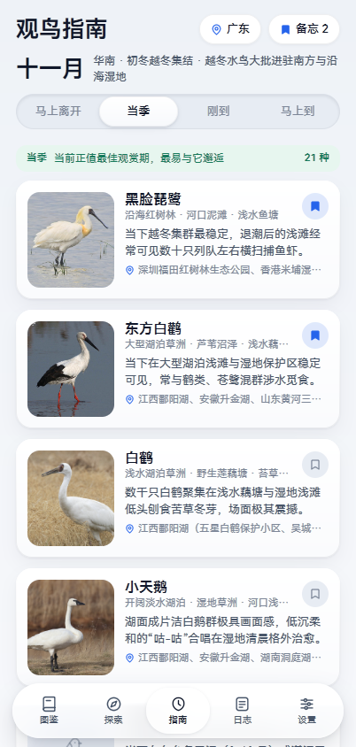
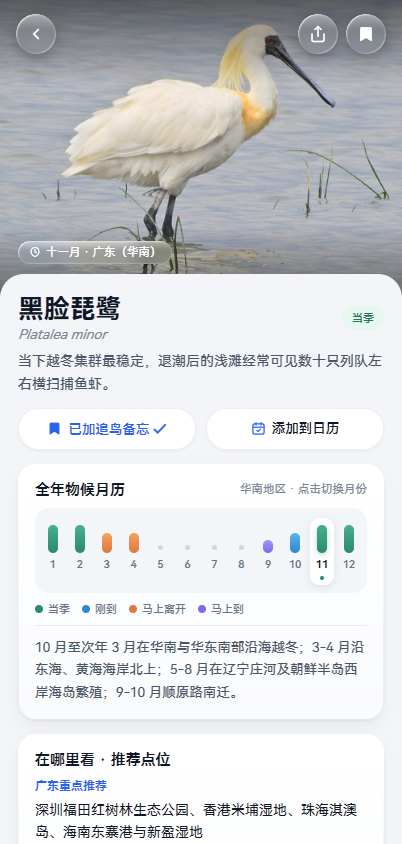
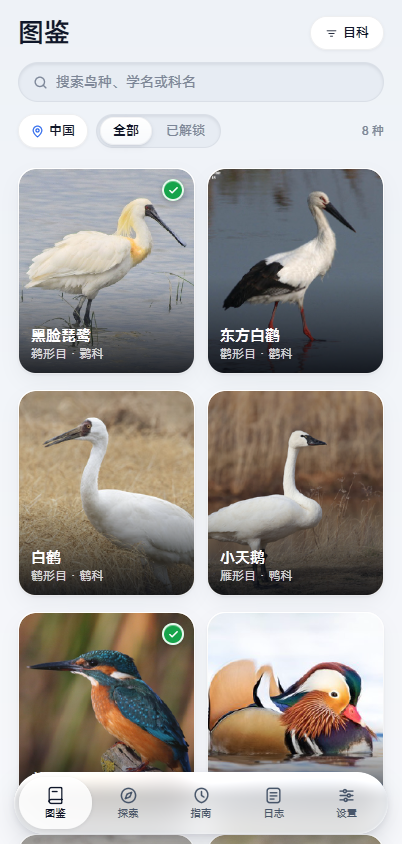
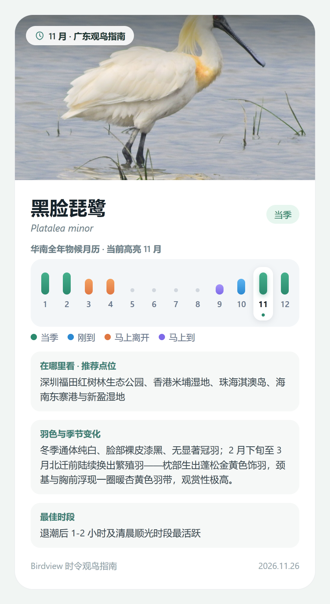
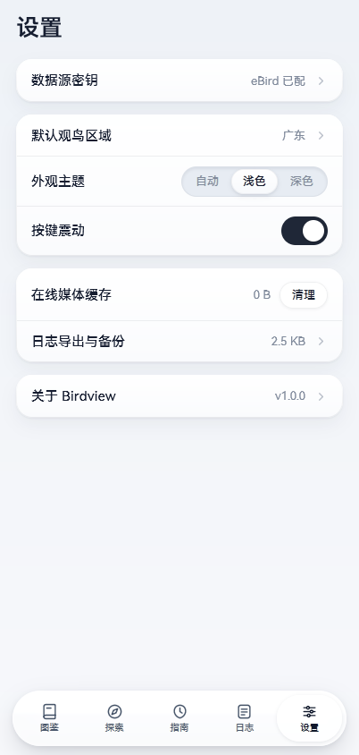

<p align="center">
  
</p>

<h1 align="center">Birdview v1.0.0</h1>

<p align="center">
  轻盈纯粹的掌上观鸟图鉴、时令物候指南与野外记录手账
</p>

<p align="center">
  <a href="https://github.com/Darastas/Birdview/releases/latest"><strong>前往下载 Android APK (v1.0.0) →</strong></a>
</p>

---

## 界面预览

<table align="center">
  <tr>
    <td align="center"><br /><sub><b>时令观鸟指南</b></sub></td>
    <td align="center"><br /><sub><b>物候月历与点位详情</b></sub></td>
    <td align="center"><br /><sub><b>全出血多图图鉴</b></sub></td>
    <td align="center"><br /><sub><b>精美排版长图分享</b></sub></td>
    <td align="center"><br /><sub><b>简洁偏好设置</b></sub></td>
  </tr>
</table>

---

## 产品亮点

### 1. 时令观鸟指南 · 这个月去哪看什么鸟
- **按月按地自动匹配**：无需再手动翻找厚重工具书，打开即可查看你所在省区当月最值得关注的水鸟、猛禽与林鸟，并贴心分为 **马上离开 · 当季 · 刚到 · 马上到** 四大时令队列。
- **全年物候月历与换羽演变**：点开任意鸟种即可浏览 1–12 月柔和胶囊物候韵律月历，直观对比过境、越冬与繁殖月份；并收录繁殖羽/冬羽换羽变化、最佳观察时段与具体到湿地公园的推荐点位。
- **追鸟备忘、手机日历与卡片分享**：遇到心仪目标点一下加入 **追鸟备忘**，支持标为已见、一键写入 **手机系统日历** 提醒，并可自动排版成精美清单长图或单鸟时令海报分享给鸟友。

### 2. 鸟类图鉴 · 摄影画廊与鸣声百科
- **中国与全球鸟类中文名录**：支持切换全国名录、单省区名录与全球名录，覆盖 **45 目 249 科** 中文检索，并可一键只看已解锁鸟种。
- **多图精选画廊与声景试听**：按需流式拉取每一种鸟的多张生态高清大图（支持全屏双指缩放灯箱）、野外实录鸟鸣音频与中文维基百科摘要。
- **终身鸟种图谱**：记下一条观鸟日志即自动点亮对应鸟种，卡片右上角亮起绿色解锁徽标，记录你的观鸟里程碑。

### 3. 周边探索 · 现场实拍与近期目击
- **四大动态板块**：集成免 Key 即可浏览的 **现场实拍**（来自周边观鸟者当次上传的真实野外照片与现场录音），以及 **近期目击**、**珍稀记录** 与 **观鸟热点**。
- **GPS 自动定位与省市直达**：支持手机 GPS 一键定位并自动识别所在城市，或直接搜索切换全国省区与全球经纬度/地区码。
- **智能会话缓存**：切换子页面保留已加载内容与浏览位置，告别每次切换都要重新转圈等待。

### 4. 观鸟日志与手账分享 · 私密存于本机
- **图文与现场录音齐备**：记录鸟种时支持智能中文/拉丁名联想，直接拍照或从相册选图，并可按住麦克风实时录制高清晰 **野外鸟鸣 WAV 音频**。
- **自动排版精美图片分享**：支持为单条目击生成明信片式观鸟手账，或将历史记录自动排版成长图海报保存与分享；同时支持 **CSV 表格备份**。
- **隐私安全**：你的个人观鸟日志、照片与录音全程仅存储在手机本地，API Key 由系统安全凭据库加密保管。

### 5. 细腻轻盈的移动端手感
- **滚动自动隐现的光学悬浮底栏**：向下浏览长列表时底部导航栏丝滑收起，上滑即刻柔和浮现，把更多视野留给飞羽与文字。
- **主题与全域触感反馈**：支持 **跟随系统 / 浅色 / 深色** 实时切换，全应用按钮与分段控件配以温和精准的按键震动（支持在「设置」中随时一键关闭）。

---

## 快速开始

1. 前往 [**GitHub Releases**](https://github.com/Darastas/Birdview/releases/latest) 下载最新版 **`birdview-1.0.0.apk`** 并安装到 Android 手机（支持 Android 8.0 及以上）。
2. 安装后无需登录或填写复杂配置，即可直接使用 **观鸟指南**、**现场实拍** 与 **本地观鸟日志**。
3. 如需解锁 **近期目击、珍稀记录、观鸟热点与完整地区物种名录**，可前往「设置 → 数据源密钥」免费申请并填入个人 **eBird API Key**（可选补充 **Xeno-canto API v3 Key** 扩展专业鸟鸣曲库）。

---

## 致谢与源码构建（开发者）

- **数据与媒体致谢**：分类与区域目击数据来自 [eBird API v2](https://ebird.org/)，物种生态多图、现场实拍与野外录音来自 [iNaturalist](https://www.inaturalist.org/)，扩展鸟鸣来自 [Xeno-canto v3](https://xeno-canto.org/)，物种中文摘要来自中文维基百科。
- **本地运行与打包**（需 Go `1.27+`，Android 打包另需 Android SDK / NDK / JDK 17）：

```bash
# 运行完整自动化测试
go test -v ./internal/...

# 桌面端手机视口预览运行
go run .

# 构建 Android Release APK / AAB（输出 build/android/birdview-1.0.0.apk）
go tool mygo build -platform android
```
